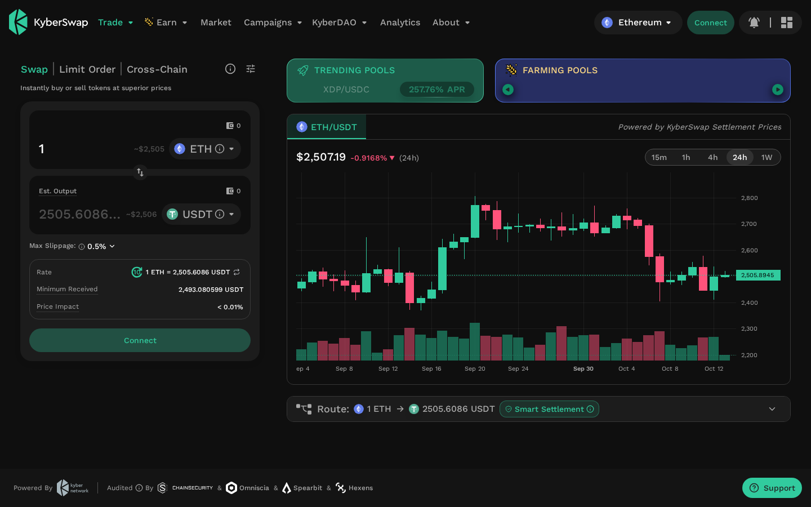
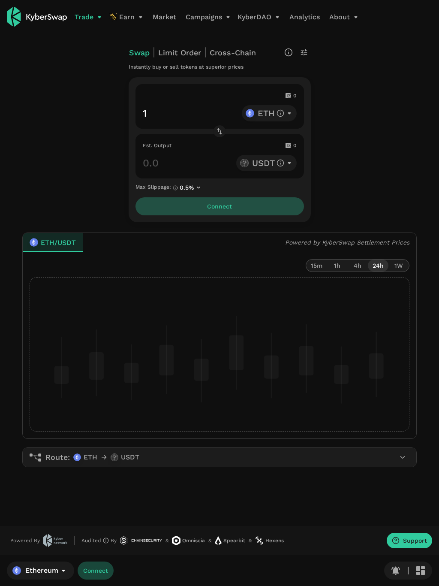
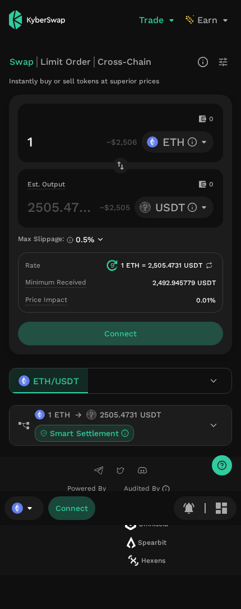
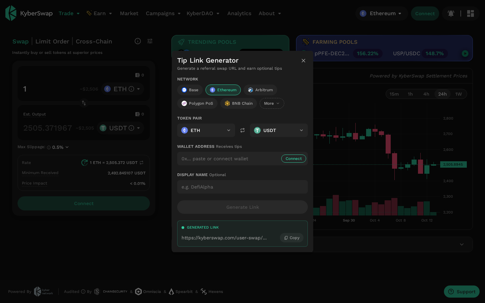

---
title: "KyberSwap Review 2026: How to Use the DEX Aggregator + Create Your Referral Link (Step-by-Step)"
slug: "kyberswap-review-tutorial-referral"
date: "2026-10-14"
author: "Editorial Team"
category: "DEX Reviews"
tags: ["KyberSwap", "DEX", "DeFi", "crypto swap", "referral", "tutorial"]
excerpt: "Complete KyberSwap guide — swap tokens, earn via liquidity, and monetize your audience with the Tip Link Generator. Updated October 2026."
featured_image: "screenshots/kyberswap/desktop.png"
---

# KyberSwap Review 2026: The Multi-Chain DEX Aggregator That Finds You Better Rates

**Quick Verdict:** KyberSwap is one of DeFi's most capable DEX aggregators — routing trades across 420+ liquidity sources on 19 chains with zero protocol swap fee. The interface is clean, the chains coverage is wide, and the built-in Tip Link Generator lets anyone create a referral link in under 30 seconds. If you trade across chains regularly, it earns a spot in your workflow.

---

## What Is KyberSwap?

KyberSwap is a **non-custodial DEX aggregator** built by Kyber Network, a Singapore-based DeFi protocol founded in 2017 by Dr. Luu The Loi and Victor Tran Huy Vu. It launched on Ethereum mainnet in 2018 and raised $52 million in its initial token sale — with Vitalik Buterin as an early advisor.

The aggregator works by splitting your swap across hundreds of liquidity pools — from Uniswap and Curve to Kyber's own pools — and executing through whatever route returns the most tokens to your wallet. You never deposit funds; every swap is a single transaction you sign from your own wallet.

**Key stats (October 2026):**
- 420+ liquidity sources aggregated
- 19 EVM-compatible chains supported
- Zero protocol fee on standard swaps
- Audited by ChainSecurity, Omniscia, Spearbit, and Hexens

---

## Interface: Desktop, Tablet, Mobile

KyberSwap is fully responsive across all screen sizes.

### Desktop (1440px)

*The desktop view shows the swap widget alongside a live ETH/USDT chart and trending pools panel — everything visible without scrolling.*

### Tablet (1024px — iPad)

*On iPad, the layout stacks the chart below the swap widget. Navigation stays as a full top bar — no hamburger menu until you hit mobile.*

### Mobile (430px — iPhone 16 Pro Max)

*The phone layout collapses to a compact swap widget with chain/wallet selectors pinned to the bottom bar. The interface remains fully functional — nothing hidden behind nested menus.*

---

## Core Features

### 1. Swap (Aggregator)
The flagship feature. Enter the token you want to sell, select what you want to receive, and KyberSwap's Smart Settlement engine queries 420+ sources in real time to find the best route.

**What makes it different from going to a single DEX:**
- Splits large trades across multiple pools to minimize price impact
- "Smart Settlement" compares candidate pools on-chain at execution time — not just at quote time — protecting against last-second manipulation
- No protocol fee: the only costs are network gas + the pool's own swap fee (already reflected in the quoted output)

### 2. Limit Order
Set a price target and KyberSwap watches the market. When your price is hit, the order fills gaslessly (you sign once off-chain via EIP-712; settlement happens on-chain when matched).

**Fee:** 0.01%–1% depending on token volatility.

### 3. Cross-Chain Swap
Swap tokens across different networks in one transaction — e.g., swap ETH on Ethereum for MATIC on Polygon without bridging manually.

**Fee:** 0.05%–0.25% depending on route and token volatility.

### 4. KyberEarn (Liquidity Provision)
Provide liquidity to concentrated-liquidity pools and earn swap fees. Smart Exit lets you set automated withdrawal rules — target price, fee threshold, or time — so your LP position exits automatically without you watching the screen.

### 5. Market Overview & Analytics
Live token prices powered by KyberSwap's on-chain price service, refreshed every 10 seconds. Useful for quick price checks without connecting a wallet.

---

## Supported Chains (October 2026)

KyberSwap covers 19 chains including:

| Type | Chains |
|------|--------|
| Layer 1 | Ethereum, BNB Chain, Avalanche, Fantom |
| Layer 2 (Ethereum) | Arbitrum, Optimism, Base, zkSync Era, Linea, Scroll, Blast |
| Sidechains | Polygon PoS |
| Others | Mantle, and more |

> **Tip:** The chain list changes as new networks are added. Always check the chain selector in the app for the current list.

---

## Fee Schedule

| Product | Fee |
|---------|-----|
| Swap (Aggregator) | **Free** (no protocol fee) |
| Limit Order | 0.01% – 1% |
| Cross-Chain Swap | 0.05% – 0.25% |
| KyberEarn | 0.01% – 0.25% |
| Smart Exit | 0.025% – 0.3% |

**Note on positive slippage:** On some trades KyberSwap captures surplus from favorable price movements (positive slippage). This is disclosed in the interface and docs.

---

## How to Use KyberSwap: Step-by-Step Tutorial

### Step 1 — Connect Your Wallet

1. Go to [kyberswap.com](https://kyberswap.com)
2. Click the green **"Connect"** button in the top-right corner
3. Choose your wallet — MetaMask, WalletConnect, Coinbase Wallet, Rabby, and 20+ others are supported
4. Approve the connection in your wallet popup

> **No registration required.** KyberSwap is non-custodial — your wallet address is your identity.

### Step 2 — Select Your Network

1. After connecting, the chain selector appears next to the Connect button (defaults to Ethereum)
2. Click it and select your target chain — Arbitrum and Base are popular for low gas fees
3. Your wallet will prompt you to switch networks if needed; confirm it

### Step 3 — Perform a Swap

1. In the **Swap** tab, click the top token field and type the token you want to sell (e.g., ETH)
2. Click the bottom token field and select what you want to receive (e.g., USDC)
3. Enter the amount in the top field
4. Review the quote:
   - **Rate:** current exchange rate
   - **Minimum Received:** guaranteed minimum after slippage
   - **Price Impact:** effect of your trade on the pool price — ideally below 1%
5. Click **"Swap"** and confirm the transaction in your wallet

> **Slippage setting:** The default is 0.5%. For stablecoin pairs, 0.1% works fine. For volatile or low-liquidity tokens, set 1–2%.

### Step 4 — Set a Limit Order (Optional)

1. Click the **"Limit Order"** tab next to Swap
2. Select the token pair
3. Set your target price
4. Enter the amount
5. Sign the gasless order in your wallet
6. The order appears in your active orders list and fills automatically when the price is hit

---

## How to Create a Referral Link (Tip Link Generator)

KyberSwap's **Tip Link Generator** lets anyone — not just influencers — create a shareable swap URL. When someone trades through your link and chooses to tip, the tip goes directly to your wallet. KyberSwap takes nothing.

### Step 1 — Open the Generator

Go directly to: [kyberswap.com/user-swap/create-tips](https://kyberswap.com/user-swap/create-tips)

Or from the app: click the **≡ menu** in the top-right corner → **"Create Tip Link"**

The Tip Link Generator modal opens:


*The Tip Link Generator lets you configure network, token pair, and your receiving wallet address.*

### Step 2 — Configure Your Link

1. **Network:** Choose which chain your referral swap runs on (Ethereum, Base, Arbitrum, Polygon, BNB Chain, or more)
2. **Token Pair:** Select the default input/output tokens for your audience — e.g., ETH → USDC for general audiences
3. **Wallet Address:** Paste your wallet address (this receives tips). Or click **"Connect"** to auto-fill from your connected wallet
4. **Display Name** (optional): Add a name that appears on the swap interface when someone uses your link — e.g., "DefiAlpha"

### Step 3 — Generate and Copy

1. Click **"Generate Link"**
2. A URL appears in the **Generated Link** box — e.g.:
   ```
   https://kyberswap.com/partner-swap?chainId=1&inputCurrency=ETH&outputCurrency=USDC&feeReceiver=0xYOUR_WALLET&enableTip=true
   ```
3. Click **"Copy"** and share the link anywhere — Twitter, Telegram, your blog, YouTube description

### Step 4 — What Your Referrals See

When someone opens your link, they see the standard KyberSwap swap interface with an optional tip prompt. The tip is **completely optional** — the swap goes through at the same rate regardless of whether they tip. The tip amount is shown transparently before confirmation.

---

## How to Use Someone Else's Referral Link

If you receive a KyberSwap tip/referral link:

1. Click the shared URL — it opens KyberSwap with the token pair pre-filled
2. Connect your wallet and review the swap as normal
3. A small **"Tip"** section appears below the swap details — you can set the tip amount or set it to 0
4. The swap rate is identical whether you tip or not
5. Confirm the transaction

> Tips go 100% to the link creator. KyberSwap does not take a cut.

---

## For Influencers: The Affiliate Program

If you have a larger audience, KyberSwap also runs a **curated Affiliate Program** that pays a **percentage commission on trading revenue** — not just optional tips.

**How to apply:**
1. Send a DM to [@KyberNetwork on X (Twitter)](https://x.com/KyberNetwork) with your application
2. If selected, you receive a unique high-commission referral link
3. Promote it on your channels
4. Track earnings in real-time via your affiliate dashboard
5. Payouts are made in **stablecoins** at the end of each period

> Note: Slots are limited — this is a curated program, not open to everyone. The Tip Link Generator above is available to all users immediately.

---

## Security: What You Need to Know

KyberSwap is non-custodial and audited by four independent firms (ChainSecurity, Omniscia, Spearbit, Hexens). The aggregator itself has never been exploited.

**The 2023 incident:** In November 2023, KyberSwap's Elastic concentrated-liquidity AMM was drained of approximately $48M via a tick-boundary exploit. This was a separate product from the aggregator routing — the swap functionality you use today was not the vulnerability. Kyber wound down Elastic and focused on the aggregator.

**Best practices when using KyberSwap:**
- Use the aggregator directly at kyberswap.com (not through third-party iframes)
- Review token approvals — revoke unused ones at revoke.cash
- Test with a small amount before large trades on new chains
- Check the "Price Impact" field — avoid trades above 5%

---

## KyberSwap vs Competitors

| | KyberSwap | 1inch | Paraswap |
|--|-----------|-------|----------|
| Chains | 19 | 13 | 9 |
| Protocol swap fee | None | None | None |
| Limit orders | ✅ | ✅ | ✅ |
| Cross-chain swap | ✅ | ✅ | ❌ |
| Referral system | Tip Link + Affiliate | ✅ | ✅ |
| Native liquidity | KyberEarn | ✅ (Fusion) | ✅ |

For pure best-rate routing across the most chains, KyberSwap's coverage is hard to beat. Always quote both KyberSwap and 1inch for large trades — the best rate varies by pair and size.

---

## Verdict

**Who KyberSwap is for:**
- DeFi traders who move across multiple chains regularly
- Liquidity providers who want automated LP management (Smart Exit)
- Content creators who want to earn from their crypto audience (Tip Links)
- Developers building DeFi apps (open aggregator API, ZaaS API, MCP server)

**Who should look elsewhere:**
- Traders who want a simple single-chain CEX-like experience (stick to Uniswap or Curve)
- Anyone specifically looking for KyberSwap Elastic — that product was shut down after 2023

**Rating: 4.2 / 5**

The chain coverage and zero-fee aggregation are genuinely competitive. The Tip Link system is the simplest referral tool in DeFi. The 2023 exploit is a real part of the story but it hit a product that no longer exists. For daily swapping across 19 chains, KyberSwap earns its place.

---

## Quick Links

- App: [kyberswap.com](https://kyberswap.com)
- Create Tip Link: [kyberswap.com/user-swap/create-tips](https://kyberswap.com/user-swap/create-tips)
- Docs: [docs.kyberswap.com](https://docs.kyberswap.com)
- Affiliate Program: DM [@KyberNetwork on X](https://x.com/KyberNetwork)
- Token approvals: [revoke.cash](https://revoke.cash)

---

*Last verified: October 14, 2026. Screenshots taken live from kyberswap.com.*
